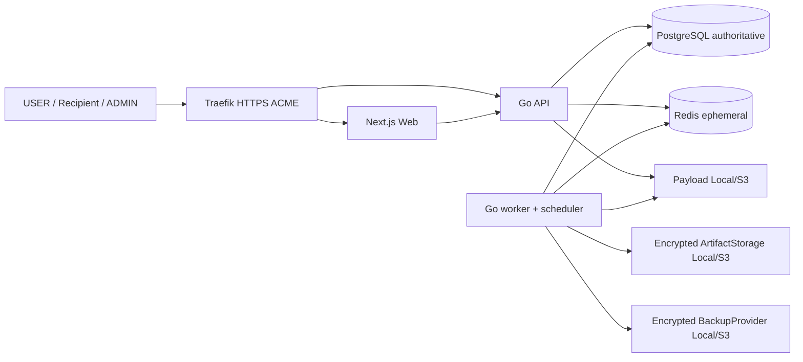
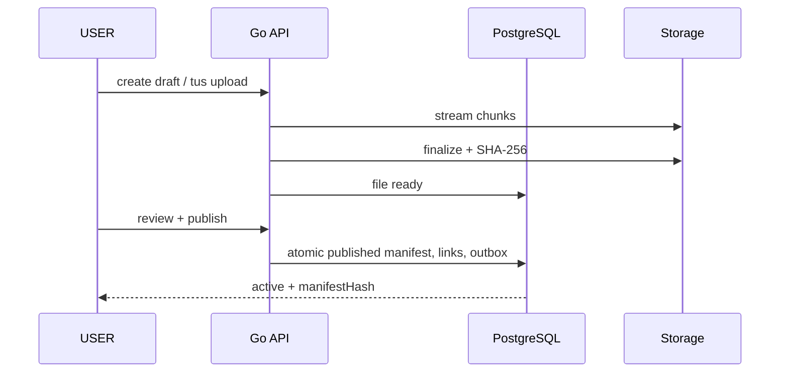
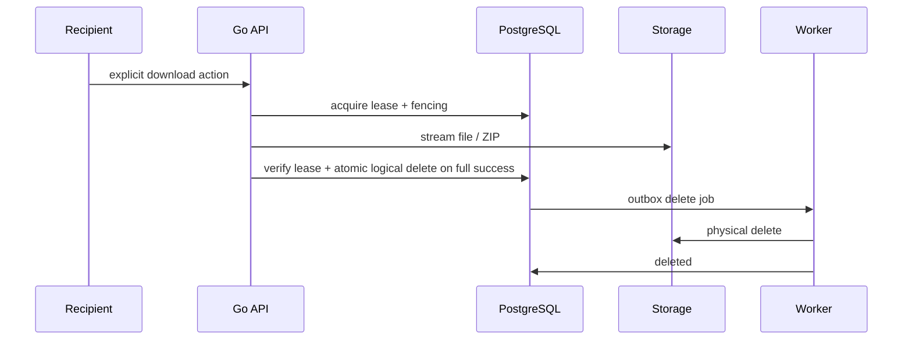

# Архитектура

- `filex-api`, `filex-worker`, `filex-cli`, `filex-verify` — отдельные Go binaries. Scheduler встроен в worker.
- API stateless относительно бизнес-состояния; PostgreSQL authoritative для transfer/file states, download leases/fencing, schedules, outbox, job metadata, audit. Redis — очереди/кэш, его потеря безопасна.
- Payload StorageProvider поддерживает несколько Local/S3, priority/fallback; ArtifactStorage — один активный Local/S3; BackupProvider — отдельный Local/S3. Payload не включён в DB backup.
- Environment: DB connection, master KEK, APP_ENV, Traefik/ACME deployment bootstrap; остальные application settings — typed/versioned PostgreSQL с draft, validate/test, atomic apply и rollback.
- API: REST `/api/v1`, tus upload, HTTP Range download, WebSocket real-time, outbound HMAC webhooks. Одна OpenAPI 3.1 + AsyncAPI.

**Критическое ограничение:** успешная передача по HTTP не доказывает сохранение файла получателем. Системный статус означает завершённую выдачу со стороны сервера в пределах наблюдаемого протокола.

## Реализация и источники деталей
[Модель данных](../wiki/data-model.md), [core contracts](../wiki/core-design.md), [фазы](../wiki/roadmap.md). Этапы 1–5 подключают repository к защищённым HTTP routes, UI и worker. Диаграмма выше содержит целевую production архитектуру: ACME/TLS и BackupProvider пока остаются фазами 6–7; локальный Compose использует loopback HTTP. Redis развёрнут, но correctness/очереди реализованы в PG. Internal health endpoints находятся на отдельном listener. Реальное состояние и ограничения: [development](../wiki/development.md).
