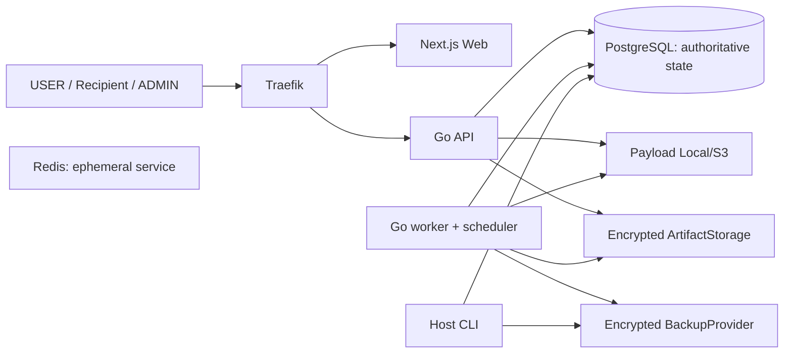

# Архитектура FileX

## Контекст и ограничения

FileX — single-origin приложение для одного VPS с Docker Compose. Go API/worker/CLI/verifier, Next.js/TypeScript, PostgreSQL, Redis, Traefik, Local/S3 — согласованный стек. Смена стека, PostgreSQL authority, one-time/privacy/crypto/recovery invariants требует согласования. Требования — [requirements](requirements.md), компоненты — [repository map](repository-map.md).

Dev Traefik публикует loopback HTTP :8090. HTTPS/ACME profile генерируется offline; TLS проверен собственной CA. Public ACME/host приёмка открыта, APP_ENV=production отвергается безусловно. Redis развёрнут, но очереди/leases/correctness текущей реализации находятся в PG; diagram не приписывает Redis authoritative роль.

## Источники истины и зависимости

- PostgreSQL: users/sessions/scopes/settings, immutable manifests, access epochs/leases/coverage, jobs/schedules/outbox, reports/snapshots и audit. SQL guards сериализуют права на выдачу и side effects; память процесса не является authority.
- Payload: несколько Local/S3 providers с priority/fallback и sticky tus placement. File salt/object key независимы от пользовательского имени; payload всегда шифруется текущим FXP1 implementation.
- ArtifactStorage: один активный provider для encrypted reports/exports/QR. BackupProvider отдельный; logical DB backup не содержит payload/artifact bytes и bootstrap KEK.
- Bootstrap env: DB connection, MASTER_KEK, APP_ENV/listeners. Typed application settings и encrypted transport/storage secrets в PG. Полный [справочник](configuration.md).
- Worker: PG outbox/leases/fences, идемпотентные задачи, scheduler. SMTP/webhook delivery at-least-once; publish не гарантирует доставку письма.

## Основные потоки

1. **Upload/publish:** owner session или scope → draft → sticky provider → PATCH encrypted chunks + committed offset → server finalize SHA/CRC/MIME/scanner → ready → atomic publish manifest/hash/TTL/links/outbox. После publish набор file/path/name immutable.
2. **Выдача:** recipient fragment token + PIN → явный POST session → opaque refs → explicit acquire file/all → PG lease/fence → guarded GET/Range → полное server-observed coverage → один atomic logical delete → worker physical cleanup. Busy/frozen/error member блокирует весь ZIP; ошибка ZIP не удаляет часть набора.
3. **Отчёты/exports:** authorized snapshot значений → immutable encrypted revision либо bounded PG export_rows → render PDF/CSV/JSON/ZIP/GZIP → verified encrypted artifact → session-bound one-use credential/Range. USER output не раскрывает recipient correlation/IP/UA; ADMIN re-auth проверяется отдельно и непрерывно.
4. **Recovery:** verified archive → close/drain → mandatory verified pre-backup → matching-schema atomic import без SQL из archive → session/lease invalidation + новая generation → restart → audit/crypto/storage reconciliation → reviewed capabilities/findings → explicit reopen. Ops control plane не откатывается.
5. **Network/upgrade:** typed policy CAS либо prepare → closed gate/generation → cancel/drain старых contexts → полный stop при upgrade/проверенный backup → strict migration prefix/locked DDL → restart/reconcile/reopen. Неправильный startup не открывает доступ.

Детали: [core](core-design.md), [file delivery](file-delivery.md), [states](state-machines.md), [data model](data-model.md), [recovery](operations-recovery.md), [upgrade](controlled-upgrade.md).

## API и trust boundaries

REST/JSON `/api/v1`, tus, single HTTP Range и WebSocket описаны в [OpenAPI](../contracts/openapi.json), [AsyncAPI](../contracts/asyncapi.json), [schemas](../contracts/schemas/). 107 операций; generator/codegen/route coverage проверяются CI. Browser идёт через тот же origin; DB/Redis/internal health не публичные. Header trust — только designated Traefik /32, не произвольная цепочка XFF. Исходящие webhooks имеют отдельный SSRF policy.

ADMIN имеет аудируемые forensic/recovery полномочия, но обычные owner-scoped endpoints не превращаются в cross-owner routes. Host CLI доверен в границе host/container, без дополнительного password, сохраняя pre-backup/schema/key/reopen guards. [Threat model](threat-model.md), [security](security.md).

## Пример и пределы гарантии

Две параллельные acquire одного файла дают одну reservation и conflict второй. После полной coverage и DB commit повторная выдача запрещена. Сбой после передачи bytes до commit может потребовать повтор bytes: сервер не доказывает fsync на устройстве получателя. Уже доставленное нельзя отозвать; физический secure erase не обещается. Atomic PG состояние не отменяет отказ внешнего хранилища; retention/compensation/reconciliation сохраняют эту границу.

[Текущий статус](current-state.md) и [план приёмки](environment-acceptance.md) отделяют local fixture evidence от внешних guarantees. Новый production допуск, реальные providers и residual risks ещё не приняты.
