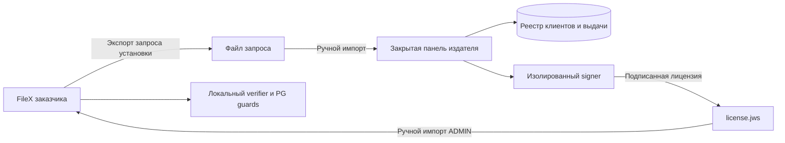

# Коммерческое офлайн-лицензирование FileX

## Контекст и статус

2026-10-14 владелец утвердил оба варианта — subscription/perpetual, закрытую веб-панель, отдельный Ed25519 ключ издателя, expiry policy и ограничения пользователей/передачи/features. Реализация текущего среза и точные границы — [операционное руководство](licensing-operations.md); проверки — [session](session.md). Остальная страница сохраняет design rationale; будущие migration/revocation grants явно отделены от реализации. Цены, договор и внешние residual risks не принимаются автоматически.

FileX обслуживает одну установку без организационной tenancy. Панель издателя — отдельный контур владельца продукта, отсутствующий в поставке заказчику. Лицензионные права не заменяют RBAC, проверки freeze/revoke/TTL, release acceptance и разрешение production deployment.

## Проблема и цели

Нужно выдавать проверяемые без интернета права, запрещать редактирование срока/лимитов/функций, поддерживать продление и перенос. Проверка не должна зависеть от DNS, внешнего времени, сервера активации, телеметрии или доступности панели издателя. Секрет, позволяющий выпускать лицензии, никогда не поступает заказчику.

Гарантия относится к штатному неизменённому приложению. Администратор ОС с возможностью заменить binary, ключи доверия, часы и всю БД может обойти программную проверку. Офлайн нельзя доказать уникальность работающего клона или доставить немедленный отзыв. TPM может усложнить копирование ключа, но не защищает произвольный patched verifier и не входит в базовый стек.

## Утверждённая коммерческая модель

| Свойство | Подписка `subscription` | Бессрочная `perpetual` |
|---|---|---|
| Право работы | До `expiresAt` | Без даты окончания, `expiresAt: null` |
| Обновления | Релизы до `updatesUntil` | Релизы до `updatesUntil`; старый разрешённый релиз продолжает работать |
| Поддержка | До `supportUntil` | Отдельно продлеваемая до `supportUntil` |
| Установка | Одна идентичность установки | Одна идентичность установки |
| Продление | Новая подписанная revision | Новая revision с новым сроком обновлений/поддержки |

Начальный рекомендуемый период подписки — год, но формат поддерживает произвольные явно заданные UTC интервалы. `supportUntil` информационный и никогда не блокирует runtime. Не вводить скрытый grace: если он будет выбран, границы и возможности задаются подписанной политикой отдельной версии. Trial по умолчанию отсутствует: переустановка не должна запускать бесплатный период.

Утверждённые метрики v1:

- `maxEnabledUsers`: все включённые локальные USER и ADMIN, включая SSO/LDAP/JIT; не число сессий и не MAU. Получатели без аккаунта не считаются. API-токен не даёт отдельного места. Одно минимальное место ADMIN необходимо для управляемой установки.
- `maxTransferBytes`: сумма plaintext-размеров файлов одного черновика, включая активные reservations. Не размер ciphertext/ZIP и не общий размер диска.
- `features`: явный allowlist, например `webdav`, `federated_auth`, `white_label`. Состав платных пакетов пока не принят; имена тарифов — только отображение, права определяют claims.
- В v1 не тарифицировать трафик, физический диск, число скачиваний и CPU. Frozen/forensic bytes и обязательный cleanup делают простую физическую квоту неоднозначной. Такие метрики требуют отдельной модели учёта.

Численные лимиты положительные; `null` явно означает unlimited; отсутствующее обязательное поле ошибочно, ноль не означает unlimited. Безусловные технические ограничения FileX продолжают действовать даже при unlimited.

Downgrade ниже текущего количества пользователей не удаляет и не отключает их автоматически: `over_limit` блокирует создание/включение пользователей до устранения превышения. Existing users могут завершать работу; это явное мягкое правило downgrade, а не обещание жёсткого ограничения уже существующих учётных записей. Превышение размера отдельного черновика блокирует увеличение и publish этого черновика, но позволяет уменьшение/удаление. Применение новых feature limits закрывает новые платные операции; существующие SSO users должны иметь заранее настроенный локальный способ входа, ADMIN получает предупреждение при preview.

## Контуры и поток данных



1. Bootstrap создаёт CSPRNG installation ID; он хранится в сохраняемом operations control plane. ADMIN экспортирует request: версия, product, installation ID, request ID. Customer/order ID задаёт издатель, не доверяет значению из запроса.
2. Оператор панели связывает запрос с клиентом/заказом, выбирает модель, даты, лимиты и функции; preview показывает точные права, fingerprint установки и изменения относительно предыдущей выдачи.
3. Панель резервирует уникальные `(entitlementId, revision)` и idempotency key, сохраняет точные bytes claims и hash. Signer подписывает только разрешённый профиль.
4. После проверки результата панель сохраняет неизменяемый artifact и журнал. Оператор скачивает файл и передаёт заказчику разрешённым каналом. В задаче нет автоматической рассылки.
5. ADMIN FileX делает preview, видит проверенную подпись, клиента, сроки и последствия downgrade; reauth + CAS apply атомарно обновляют entitlement, epoch и audit. Неверная новая лицензия не стирает действующую.
6. API/worker/CLI проверяют локальные права и PostgreSQL epoch при каждом защищённом действии. UI только объясняет результат, не является enforcement boundary.

Запрос установки не доказывает покупку или владение хостом. Случайный ID удобнее MAC/IP/hostname: смена сети и контейнеров не ломает лицензию. Знание/копирование ID позволяет скопировать привязку; это защита от случайного применения чужого файла, не аппаратная anti-clone гарантия. Если нужна более сильная привязка, отдельный TPM-профиль с proof-of-possession и recovery необходимо проектировать отдельно.

## Формат и криптографическая проверка

Используется JWS Compact с отдельной vendor Ed25519 парой. Стандартный алгоритм и wire encoding по [RFC 7515](https://www.rfc-editor.org/rfc/rfc7515), [RFC 8037](https://www.rfc-editor.org/rfc/rfc8037), [RFC 8032](https://www.rfc-editor.org/rfc/rfc8032). Это не JWT с произвольными алгоритмами. Нормативный заголовок профиля v1: `{"alg":"EdDSA","kid":"vendor-2026-01","typ":"filex-license+jws"}`; EdDSA допускается исключительно с Ed25519.

Illustrative claims; UUID и даты ниже — пример, не действующая лицензия:

```json
{
  "schemaVersion": 1,
  "product": "filex",
  "issuer": "filex-vendor",
  "licenseId": "b5582e28-44f0-43ea-8653-e35c9231e437",
  "entitlementId": "fe675ab3-d9f2-4ea9-85c9-8865eae589e5",
  "revision": 3,
  "customerId": "customer-0042",
  "installationId": "49ca5e21-4f82-4a02-93d9-a2f939c711f5",
  "kind": "subscription",
  "issuedAt": "2026-10-14T09:00:00Z",
  "notBefore": "2026-10-14T09:00:00Z",
  "expiresAt": "2027-10-14T09:00:00Z",
  "updatesUntil": "2027-10-14T09:00:00Z",
  "supportUntil": "2027-10-14T09:00:00Z",
  "limits": {"maxEnabledUsers": 50, "maxTransferBytes": 10737418240},
  "features": ["webdav", "federated_auth", "white_label"]
}
```

`licenseId` уникален для выдачи; `entitlementId` неизменен на всю цепочку продлений установки; revision строго возрастает и не сбрасывается при смене signing key. Не складывать права из нескольких лицензий. Perpetual использует `expiresAt: null`, остальные даты остаются явными. Для срока работы интервал `[notBefore, expiresAt)`. Для entitlement на обновление сравниваются дата публикации релиза в подписанном vendor release metadata и `updatesUntil`, а не время сборки на машине заказчика. Подпись/тип release metadata используют отдельный профиль/ключ; разработка этого контракта обязательна до enforcement обновлений. Security backports без продления — отдельное продуктовое решение.

Порядок проверки:

1. Bounded input (предлагаемый максимум 16 KiB), ровно три непустых сегмента, strict unpadded base64url, 64-byte signature. Запрет trailing bytes и невалидного UTF-8.
2. Strict header: запрет duplicate keys, неизвестных полей и всех алгоритмов кроме заданного; нет `jku`, `x5u`, `jwk`, `crit`, `b64=false`, `none` или загрузки ключа из файла лицензии. `kid` выбирает ключ только из встроенного vendor allowlist.
3. Verify подпись над исходными JWS signing-input bytes; никогда не пересобирать JSON перед Verify. Нет собственного алгоритма canonicalization. Затем strict claims parser, duplicate/unknown keys rejection, типы/длины/ranges, allowlist features, безопасные целые без float coercion.
4. Проверить product/issuer/schema, binding, kind/dates и monotonic revision; затем оценить runtime policy по времени/usage. Корректная подпись сама по себе не означает применимость лицензии.

Private vendor key не связан с `MASTER_KEK`, payload/report/ZIP keys заказчика и не хранится в его БД или Docker image. Подмена public key через env/settings/file upload запрещена в штатной поставке. ZIP signing остаётся без изменений. Test keys только в тестовом профиле и не входят в release trust roots; нельзя включать bypass через `APP_ENV=development` в коммерческой сборке.

## Закрытая панель генератора

Отдельное развёртывание Go + Next.js + PostgreSQL, отдельные credentials/backup/security boundary; никакого маршрута vendor-admin в клиентском FileX. Предлагаемые экраны: клиенты/заказы, установки, entitlements, новая выдача с diff/preview, история immutable artifacts, ключи с публичными fingerprint, журнал действий и заявки на перенос. Платежи и бухгалтерия вне v1; оператор ссылается на внешний order ID.

Роли: viewer, issuer, security administrator. Вход только назначенным сотрудникам, обязательные MFA и reauth перед выпуском/ротацией/отзывом, no public signup. Issuer не управляет ключами доверия. Экспорт private key через UI запрещён. Рекомендуется подтверждение вторым сотрудником для ротации, переноса и повышения лимитов вне утверждённого каталога; правила утверждает владелец, автоматических approvals нет.

Signer отделён от web frontend и основной API роли; private key доступен только signer через секрет-хранилище издателя или HSM с поддержкой выбранного алгоритма. Конкретный provider/escrow не выбран. В dev применяются только throwaway keys. Signer проверяет сервисную аутентификацию, профиль, одобренный issuance ID/hash и ограничения, а не предоставляет универсальную `sign(bytes)` ручку браузеру. Компрометация уполномоченного signer/issuer остаётся критическим риском; MFA сама по себе его не устраняет.

Выдача: `draft → approved → signing → issued`; ошибка оставляет `signing_failed` с тем же immutable request. Уникальный idempotency key+request hash, serializable reservation revision, durable issuance journal и outbox. После сбоя между подписью и записью retry использует те же bytes/ID/revision; новый request с прежним idempotency key отклоняется. Никогда не выдавать два разных payload одной revision. Файл доступен только после сохранения и Verify; повторное скачивание возвращает тот же artifact/hash. Issued records не редактируются/не удаляются, исправление — новая revision.

До начала реализации панели: подготовить отдельные OpenAPI 3.1, JSON Schemas и AsyncAPI внутренних issuance events из generator sources; контракты клиентского FileX не должны объявлять vendor endpoints. Audit содержит actor/action/ID/hash/result, без ключей и полного лицензионного файла. Бэкап реестра и независимое escrow signer key проверяются восстановлением; потеря ключа не должна приводить к повторному использованию `kid` с другим public key.

## Runtime states и безопасное ограничение работы

Состояние выводится из signature/binding/revision/time и usage; deadline не зависит от запуска scheduler. Отдельные поля `entitlementState` и `overLimit` предотвращают потерю причин. Статусы: `missing`, `not_yet_valid`, `active`, `expired`, `invalid`, `clock_suspect`. `update_not_entitled` относится к кандидату обновления, не к уже работающему разрешённому binary.

| Ситуация | Новые платные действия | Данные и управление |
|---|---|---|
| `active`, лимиты соблюдены | Разрешены по features и RBAC | Обычные guards |
| `overLimit` | Только действия, не увеличивающие соответствующее превышение | Уменьшение/отключение/cleanup разрешены |
| `missing` / `invalid` / `not_yet_valid` / `expired` / `clock_suspect` | Запрет новых draft/upload/publish, выдачи новых write credentials и создания пользователей | Recovery, импорт лицензии, доступ ADMIN и существующих пользователей, revoke/delete, audit/backup/cleanup остаются |
| Обновление за `updatesUntil` | Upgrade prepare отклоняет кандидат до migrations | Текущий разрешённый релиз работает; не делать автоматический downgrade БД |

Предлагаемая политика continuity: ранее опубликованные передачи продолжают обычную выдачу, Range/ZIP и one-time deletion до **своего** TTL. Лицензия не продлевает TTL и не обходит freeze/revoke. Существующие отчёты, owner draft чтение и safety/recovery доступны по прежней авторизации. Новые произвольные paid export jobs запрещены, integrity/security reports и уже принятые jobs завершаются. Лицензия не шифрует данные новым недоступным ключом и не запускает их удаление. Обязательное удаление по исходным retention правилам продолжает действовать.

Upload проверяет policy на каждой bounded записи и final commit; частично загруженное остаётся draft для resume после продления либо удаления. WebDAV PUT final swap, tus finalization и publish используют те же guards. Feature downgrade останавливает новые DAV записи, не recipient downloads. Отключение federated auth не блокирует license recovery через локальный ADMIN. Общий deployment/recovery/security gate имеет приоритет над этим разрешением continuity.

## PostgreSQL authority и гонки

Предлагаются новые license control-plane tables с signed envelope, fingerprint, entitlement/revision high-water, epoch, installation ID и maxObservedAt. Derived claims не источник прав: сервер сверяет их с подписанным envelope; разница fail-closed для новых платных операций. Переписанная строка `max_users=999` не выдаёт новые права.

Все user creation/enable/JIT и volume reservations сериализуются через короткий общий row lock; после блокировки повторно проверяются license epoch, validity и счётчик. Для unknown-length WebDAV резервировать перед каждым bounded append; replacement учитывает видимый файл и staged candidate по явно заданной логической квоте, без двойного списания финального размера. Physical transient overhead не входит в коммерческую квоту и имеет технические storage limits. Reservation release идемпотентен; crash cleanup по leases/fencing не освобождает место живого writer.

Apply новой лицензии использует тот же lock и атомарно меняет epoch/audit/outbox. API/worker/CLI не могут продолжить увеличение usage с устаревшей revision. Кеш допустим только для криптографической проверки exact bytes + trust version, а не для авторизации по старому PG epoch; Redis/in-memory counters не authority. При недоступности PG нет нового разрешения из кеша.

Неисполненные queued jobs повторно проверяют entitlement перед side effect; safety jobs не останавливаются. Многочасовая транзакция для потока не нужна: короткие guards и reservations, повторные checks, прежние runtime locks/fences.

## Rollback, продление, перенос и ключи

- Локально `effectiveNow = max(current UTC, persisted maxObservedAt)`; процесс дополнительно использует monotonic elapsed time, чтобы остановленные часы не продлевали текущую сессию. Откат UTC больше предлагаемого допуска 5 минут → `clock_suspect` и restricted new work. Точный tolerance — часть фиксированной версии policy, не настройка ADMIN.
- `maxObservedAt` и accepted revision сохраняются в operations control plane, который штатный restore не откатывает. Это выявляет обычный DB restore/старую лицензию, но не rollback всей VM/диска с тем же состоянием. Fast-forward clocks могут преждевременно закрыть подписку; восстановление через проверенный support workflow, без кнопки обнуления времени.
- Повтор exact envelope/hash текущей revision идемпотентен; меньшая revision отвергается; тот же номер с другим hash — конфликт. Новый `licenseId` не обнуляет high-water. Смена entitlement ID требует отдельного vendor-signed migration grant, а не импорта произвольной другой цепочки.
- Будущая `notBefore` лицензия может храниться как pending, не заменяя активную до начала срока. Pending revision и active revision учитываются раздельно, чтобы раннее продление не выключило установку.
- Migration на новый хост: реестр издателя связывает old/new installation ID, выпускает replacement с явным основанием. Старую автономную установку технически выключить невозможно; offline deactivation receipt подтверждает лишь локальное действие, не уничтожение копий. Параллельное использование ограничивается договором; договорные условия разрабатываются отдельно.
- Cold standby/DR может использовать ту же installation identity при единственной активной установке; обеспечить единственность между разобщёнными хостами программно нельзя. Fresh-instance recovery требует vendor reissue/переноса или сохранённого control-plane backup, а не самоназначения ID из лицензии.
- Ротация vendor key: сначала доставка нового доверенного public key через проверенное обновление продукта, затем выпуск новым `kid`. Старые ключи сохраняются для действующих лицензий. Компрометация требует ручной доставки обновлённого trust/revocation bundle и перевыпуска; уже изолированная машина не узнает об отзыве сама.
- Отзыв в панели означает `revoked_at_issuer`, а не доказанный отзыв на клиентах. Импорт подписанного revocation bundle может локально закрыть новые операции; версия bundle monotonic и не откатывается штатным restore. Пока формат не реализован, UI не должен обещать эту функцию.

## Модель угроз и review проекта

| Угроза | Контроль | Граница |
|---|---|---|
| Изменение лимита/дат/функций | JWS подпись, strict schema | Нужен доверенный verifier |
| Свой public key в лицензии | Встроенный allowlist, запрет embedded/remote keys | Root может заменить binary |
| Лицензия другой установки | Signed installation ID, local binding | Копия identity клонируется |
| Старый файл после downgrade | Entitlement revision high-water | Полный rollback хоста не определяется |
| Обход через DAV/CLI/JIT/worker | Общие PG guards на доменных границах | Нужна проверка всех write paths |
| Гонка за последнее место/байты | PG serialization, reservations, epoch | DB superuser вне доверенной границы |
| Недоступность/взлом панели | Runtime автономен; отдельный signer/MFA/audit | Украденный signer key позволяет подделку |
| Истечение ломает хранение и выдачу | Continuity policy и независимые safety jobs | Политика требует утверждения |
| Бессрочная лицензия даёт все новые версии | Проверенный release metadata + updatesUntil | Patch/старый клиент с устаревшим trust store |

Внутренний architecture review спецификации: PostgreSQL authority, shared guards, immutable payload, atomic ZIP, retention и privacy сохранены при предложенной continuity policy. Панель издателя не вводит tenancy в FileX. License gate не открывает production guard. Таблица ops_license входит в существующее исключение ops_* при restore, поэтому installation identity и high-water не заменяются данными архива; полное копирование PostgreSQL/VM выходит за эту гарантию.

Внутренний crypto review спецификации: стандартная асимметричная подпись, no shared HMAC secret у клиента, pinning public keys, exact input bytes и изоляция классов ключей. **Согласовано 2026-10-14:** отдельные vendor signing keys для license/release metadata; instance ZIP key по-прежнему только SHA256SUMS. Независимый review не выполнен; residual risks root/clone/clock/offline revocation не приняты за владельца.

## План реализации и критерии проверки

| Срез | Будущие компоненты/контракты | Обязательная приёмка |
|---|---|---|
| LIC-01: формат и verifier | `internal/licensing`, generator schema sources, golden vectors | Каждый изменённый byte, wrong key/product/binding, duplicates, invalid UTF-8, overflow, oversized input, unknown enum, fuzz; независимые vectors |
| LIC-02: панель и signer | Отдельный vendor deployment, OpenAPI/AsyncAPI, issuer registry | MFA/roles/CSRF/reauth, key isolation, double issue race, retry после signer/DB fault, immutable artifacts, backup restore |
| LIC-03: импорт и state | PG migration, ADMIN UI/API, host CLI, audit | Invalid import сохраняет active; CAS race, renewal/pending, expiry boundary, rollback clock, штатный restore high-water |
| LIC-04: quotas/features | Domain guards, JIT/local users, tus/DAV, workers | Параллельное последнее место, concurrent uploads/replacement, crash reservation, stale epoch, downgrade и все обходные каналы |
| LIC-05: обновления и эксплуатация | Release metadata/trust, upgrade prepare, runbooks | Perpetual old release работает, неподходящий update отклоняется до migration, key rotation/unknown kid, migration/DR |
| LIC-06: qualification | Traceability, RU/EN UI/help, release gates | Air-gapped end-to-end, отсутствие license network requests, negative/concurrency/fault/browser/security gates на exact source |

Это проектная матрица будущих проверок, не `verified` evidence. После согласования добавить лицензионные requirements и tests в `contracts/traceability.json`, генерировать `wiki/test-matrix.md`, синхронизировать OpenAPI/AsyncAPI/JSON Schema через scripts. Не редактировать generated contracts вручную и не объявлять несуществующие routes частью текущего API.

## Коммерческие и внешние решения

Подтверждены коммерческие модели, панель, метрики, expiry policy и vendor Ed25519 профиль. Цены, feature packages, специальная политика security backports, юридический LICENSE и внешняя приёмка остаются отдельными решениями. Trial/grace в v1 нет. Фактические ограничения переноса/отзыва описаны в операционном руководстве.

## Подтверждение владельца — 2026-10-14
Владелец явно утвердил отдельный Ed25519 ключ издателя, политику истечения и ограничения по пользователям, размеру передачи и функциям; поручил реализацию лицензирования и закрытой веб-панели. Это снимает ранее указанный блокер согласования crypto/license policy. Реализация начата; внешний review, остаточные риски и production deployment автоматически не приняты.
