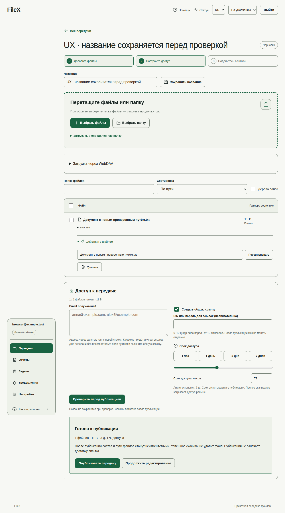

# Удобство интерфейса: ревью и реализация

## Контекст
Интерфейс Next.js обслуживает владельца передачи, получателя и администратора одной установки. Общие цвета, название и иконки задаёт [брендинг](white-label.md). Задача — уменьшить число действий и визуальную перегрузку без ослабления серверных инвариантов. Решение — [ADR-015](adr/015-product-ux.md).

## Ревью исходного состояния
| Сценарий | Проблема | Решение |
|---|---|---|
| Навигация | Горизонтальные секции, длинные страницы без ориентира | Постоянная навигация и тематические подразделы, подсказки и иконки |
| Черновик | Переименование каждого файла всегда раскрыто; лишнее сохранение названия | Компактные строки, раскрытие редких действий, сохранение перед review |
| Публикация | Только числовой TTL, нет заметной готовности | Шаги, presets/range/точный ввод, проверка получателей и понятное review |
| Списки | Одинаковое empty при поиске и первом входе, фоновые ошибки скрыты | Отдельные loading/empty/error, сброс фильтров, stale-response guard |
| ADMIN | Все настройки и восстановление на одной странице | Разделы по задачам и reauth на месте |
| Settings v1 | Требуется редактирование JSON | Форма для всех полей с сохранением draft/validate/CAS apply |
| Уведомления | Ручной timezone и два несвязанных числа quiet hours | Выбор timezone и часов, включение quiet hours одной настройкой |
| Получатель | Старый список и действия после terminal denial | Privacy-safe недоступное состояние, отдельная ошибка сети и resume |

## Реализация и поток данных
Реализованы перечисленные изменения; статус browser и остальных проверок — [evidence](history/product-ux-evidence-2026-10-13.md) и [session](session.md). Новый owner-scoped GET `/api/v1/transfers/{id}/editor` возвращает `message`, чтобы редактирование названия сохраняло сообщение при существующей full-replacement семантике PATCH, и `maxTtlSeconds` — действующий несекретный предел публикации из Settings v1. Сервер повторно проверяет его при publish. Прежний detail DTO не меняется, strict API compatibility сохраняется; новых env/migrations нет.

### Передать файлы
1. Открыть «Новая передача», ввести название и добавить файлы/папку. DnD и возобновление используют прежний tus pipeline.
2. Редкие действия пути, WebDAV и переименования раскрываются отдельно. Удаление файла сначала показывает его имя и последствия; Escape отменяет без запроса DELETE.
3. Получателей указать через запятую или с новой строки. Пустой список допустим с общей ссылкой. Формат `email;индивидуальный пароль` по-прежнему поддерживается; PIN без отдельного значения применяется к соответствующим ссылкам.
4. Выбрать срок пресетом, ползунком или точным числом. Показаны только пресеты до лимита установки (в том числе 30 дней при достаточном лимите), доступно точное максимальное значение. Исходный срок — сутки либо меньший лимит. Числовое поле использует часы, минуты или секунды в зависимости от лимита; дробные часы/минуты округляются до секунды. Неверный PIN/адрес/срок блокирует review с пояснением. Смена политики во время работы учитывается при refresh и повторно на сервере при publish.
5. «Проверить перед публикацией» сохраняет изменённое название, читает свежие файлы и фиксирует проверяемую revision. Изменение файлов в другой сессии закрывает review; publish со старой revision отклоняется сервером. Затем явная публикация создаёт ссылки.

Смена названия предварительно читает сохранённое `message`. Сам прежний metadata PATCH остаётся полной заменой без CAS: одновременные изменения метаданных из разных клиентов используют семантику последней записи. CAS публикации и запрет изменения опубликованного payload сохранены; новая форма не обещает совместное редактирование метаданных без конфликтов.

### Личные настройки
«Настройки» разделены на уведомления, аккаунт/безопасность и интеграции. Timezone выбирается из IANA списка; имеющееся серверное значение сохраняется даже при отличиях browser Intl каталога. Тихие часы включаются целиком и сохраняются как прежние integer hours/null. Язык и тема доступны в верхней панели. Переключение подразделов не очищает ввод.

Browser проверка обнаружила, что минимальный Alpine runtime не содержит timezone database и отклонял `Europe/Moscow`, хотя разработческий хост принимал её. API, worker и CLI теперь включают стандартный Go `time/tzdata`: валидация, локальное время отчётов и quiet hours работают без установленного на хосте пакета tzdata. Данные обновляются вместе с Go; новых env или сторонних библиотек нет.

### ADMIN
- Разделы: эксплуатация, хранение, корпоративный вход, оформление, параметры системы, почта, безопасность/аудит. На мобильном экране навигация переносится; пункты подписаны, иконки не заменяют текст.
- Подтвердить пароль можно на месте. Это прежний `/auth/reauth` с серверным сроком 5 минут; UI не создаёт собственного разрешения. Корпоративная reauth остаётся в настройках аккаунта.
- Settings v1: активная revision → поля/сроки/MIME policy/banner/network → «Сохранить и проверить» → явное применение. Черновик сам не становится активным. CAS конфликт сохраняет ввод, предлагает загрузить новую active revision; смена origin/network предупреждает о restart/reconciliation/reopen.
- Expert JSON сохраняет полный объект и проверяется перед возвращением к форме. История ревизий позволяет явный rollback с тем же CAS, без переписывания истории.
- SMTP TLS автоматически подставляет 587/465; пользовательский порт разрешён. Сохранение SMTP не доказывает доставку письма. Для переноса файлов нужны разные source/target, target должен принимать записи.

### Поиск и получение
Поиск выполняет POST после паузы ввода; raw search не попадает в URL. Поздний ответ не заменяет новый фильтр, выборка bulk сбрасывается при смене фильтра. Фоновое обновление первой страницы не обрезает список после «Показать ещё»; новый поиск начинает выборку заново.

Фоновое обновление проверяет `/auth/me` во всех разделах, включая Settings/ADMIN и раскрытую пагинацию. Отказ сессии завершает локальное представление, прерывает текущую загрузку, убирает прежние списки и чувствительные сообщения, предлагает войти. Ошибка пароля при reauth тоже имеет статус 401, поэтому действие дополнительно проверяет саму сессию: неверный пароль не выбрасывает действующего пользователя из аккаунта. У ответов есть session/view/search generation guard: старый запрос не заменяет новый фильтр и не завершает новый сеанс. Сетевая ошибка сохраняет последний список и даёт повторить обновление.

Session guard расположен также в общем owner API adapter до возврата ответа обработчику действия. Поэтому отложенное открытие передачи не может заполнить private state после logout/revoke и последующего входа другой учётной записи. Browser case удерживает настоящий editor response, отзывает сессию, входит под другим пользователем без перезагрузки документа и только затем отдаёт старый ответ; прежняя передача не должна появиться. Завершение сессии сразу сбрасывает busy: старый запрос не блокирует новый вход и не завершает индикатор нового действия; для этого busy привязан к action generation.

Recipient 401/403/404/410 очищает файлы и старый URL скачивания и показывает общую недоступность без причины. Временная сеть/5xx оставляет текущий список и resume. Поздний ответ от прежней recipient session не восстанавливает закрытые controls. Явный token в новой ссылке имеет приоритет над cookie предыдущей передачи: сначала показывается форма открытия новой ссылки, чужой старый список не подставляется. Без token в адресе допустимо продолжение текущей recipient session. UI не подтверждает сохранность файла на диске получателя.

## Ограничения
Коммерческое оформление не заменяет [внешнюю приёмку](environment-acceptance.md). Новые публичные регистрации, tenant/billing и production deployment не включены. UI использует английские технические имена MIME/CIDR/claim там, где они нужны оператору для настройки, с русскими пояснениями.

## Визуальный обзор
Снимки ниже от 2026-10-13 получены из настоящего локального Compose в Chromium, с вымышленными данными и мобильной эмуляцией. Они сохраняют контекст первоначального UX review. Полный [озвученный тур от 2026-10-14](screen-tour.md) уже переснят на объединённом UX: 71 кадр / 26 глав, включая terminal recipient, настройки, корпоративный вход и брендинг. На длинном кадре черновика ниже sticky navigation остаётся на позиции просмотра блока проверки.

| Экран | Что видно |
|---|---|
| [Черновик и проверка публикации](ux/draft-review.png) | Шаги, загрузка, действия файлов, пресеты/ползунок и итоговая проверка |
| [ADMIN: параметры системы, 320 px](ux/admin-settings-mobile.png) | Навигация, reauth, обычные поля Settings и явное применение |
| [Личные настройки, 320 px](ux/preferences-mobile.png) | Timezone, режим уведомлений и тихие часы |
| [Завершённый доступ получателя](ux/recipient-completed.png) | Общая недоступность без старых кнопок и без раскрытия причины |

